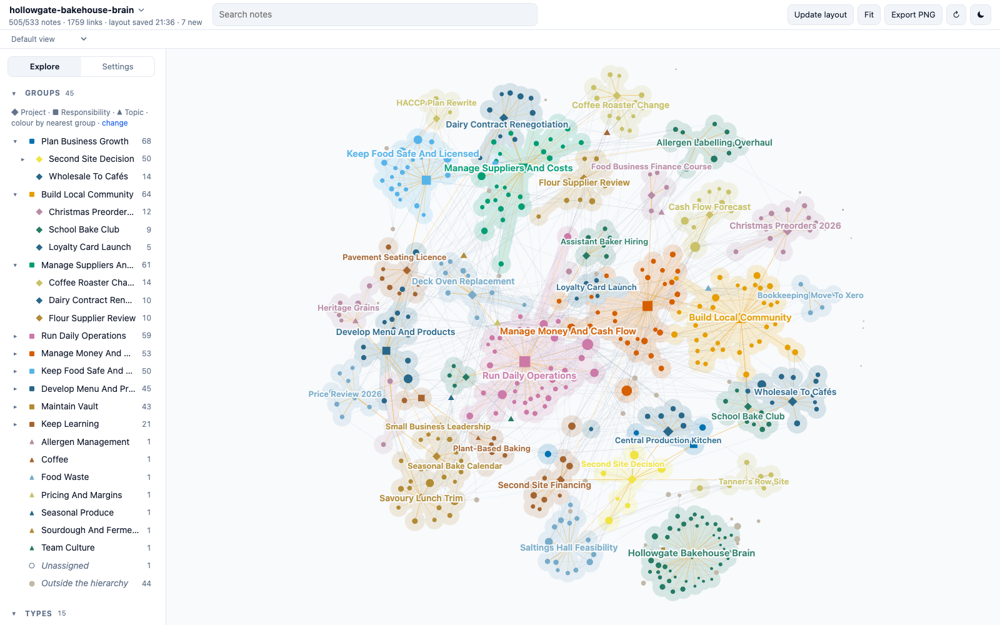

# Hollowgate Bakehouse Brain

A demo Second Brain: about 530 linked Markdown notes holding the working memory of the owner of a fictional independent café and bakery. Clone it, open the folder, and explore what a vault looks like after two years of daily use: projects, decisions, meetings, people, suppliers, open questions, and the links between them.



> [!warning]
> Everything about the bakehouse is fictional: Hollowgate Bakehouse, the town of Brackenmouth, every person, supplier, customer, the council, the bank, the accountants, the prices and the figures. Any resemblance to real people or organisations is accidental. Only the Sources marked as encyclopedia articles or tool documentation are real.

## What it shows

The vault was deployed from the [Second Brain template](https://github.com/mfoll/second-brain-template), which adds operating rules, workflows and a decision record to the [Portent](https://github.com/refactoringhq/portent) note model. Everything is plain files: Markdown notes with YAML frontmatter, typed relationships (`belongs_to`, `related_to`, `has`) and wikilinks. No app, database or index is required.

| Area | What to look at |
| --- | --- |
| Structure | 8 Responsibilities at the root, about 25 Projects under them, 10 Topics as lateral context; every note rolls up to a Responsibility. |
| Memory | About 180 Sources, 50 Events, 35 Questions, 30 Concepts, 15 Opinions, 14 Recaps, 40 people. |
| Real material | About 60 Sources are real Wikipedia articles on food safety, baking, coffee and small-business finance, cited with title and URL and summarised in our own words. Their "Why It Matters" sections describe how the fictional bakehouse uses them. |
| Operations | `AGENTS.md`, Type notes, Procedures, Skills and ADRs from the template, unchanged except for the deployment steps. |
| History | Git history from January 2025 to October 2026, one commit per month of captures. |

## Open it

- **Any Markdown editor.** Clone the repository and open the folder. Start from [[vault]].
- **[Tolaria](https://tolaria.md/).** Open the folder as a vault for typed sidebars, relationship panels and saved views.
- **[Brain Graph](https://github.com/mfoll/brain-graph).** See the whole vault as a map coloured by project:

  ```bash
  npx github:mfoll/brain-graph path/to/second-brain-demo-cafe
  ```

- **A coding agent.** Run Claude Code, Codex or Gemini CLI in the folder. They read [[AGENTS]] (through `CLAUDE.md` and `GEMINI.md` where needed) and follow the vault's Procedures.

## Try this

Each question has a known answer in the vault, so you can check what an agent finds.

| Ask | Where the answer lives |
| --- | --- |
| Why did we bring soup back after cutting the lunch menu? | A team meeting cut lunch to bakery only on 2026-02-05; a menu review on 2026-04-09 partly reversed that. See [[savoury-lunch-trim]], [[menu-review-2026-04-09]] and the daily Recap of 2026-04-09. |
| Have we decided whether to open a second site? | Still open, with the accountant and the head baker both urging caution. See [[should-we-open-a-second-site]]. |
| Why did we lose a point at the 2025 hygiene inspection? | Cooling records and a blocked hand-wash sink. See [[environmental-health-inspection-2025-06-18]]. |
| How much more are we paying for butter than in 2025? | Tracked month by month. See [[butter-price-tracker]] and [[dairy-contract-renegotiation]]. |
| Why do we take deposits on Christmas preorders? | A January cash squeeze and the forecast built after it. See [[christmas-preorders-2026]] and [[thirteen-week-cash-flow-forecast]]. |
| Why did we stop supplying other cafés with bread? | An oven failure, thin margins and baker hours. See [[why-did-we-pause-wholesale-to-cafes]]. |

Workflows to try with an agent:

- **Resume a project:** "Resume the Second Site Decision."
- **Process the Inbox:** about eight raw captures from the last week of October 2026 have `_organized: false`; each has an obvious home.
- **Ingest a source:** give any Wikipedia article on bread, coffee, food safety or small-business finance and ask where it belongs.
- **Lint the vault:** the audits should find one unresolved link and one homeless Concept, both left in on purpose.

## Scope and privacy

The fictional bakehouse's daily operations, staff rota, suppliers, food safety and licences, menu, finances, marketing and community work, the second-site decision and the owner's own learning. No staff wages, health or personal details, no customer data and no credentials; sales appear only as aggregates from the till system.

## Template updates

The vault was deployed from the template on 2026-10-23. Later template improvements can be ported with [[upgrade-existing-vault-from-template|Upgrade an Existing Vault From the Template]], as a reviewed change: an agent proposes each port, and a person approves it. Never run it unattended. A vault in use is expected to differ from the template on purpose, in its ADRs, Procedures, Skills and instructions.

## How it was made

An AI agent drafted the world specification (the bakehouse, people, projects, timeline and the storylines behind the questions above) and a person reviewed and changed it. AI agents then wrote the notes from it, one per area of the business, and retrieved the real articles from Wikipedia and the tools' public documentation. The links, frontmatter, cross-area consistency and source metadata were checked with the template's lint scripts and against the live pages.

## Storage and backup

Git history in this repository. A demo that edits notes can be reset with `git checkout .` and `git clean -fd`.

## Licence

MIT, see `LICENSE`, which also covers the template material. `THIRD_PARTY_NOTICES.txt` lists upstream notices. Cited articles and documentation remain under their own licences; the notes contain only their metadata and our own summaries.
